# 📚 ShareShelf

**A student-to-student resource-sharing platform for Galgotias University.** Borrow, exchange, donate, or give away campus items such as calculators, lab coats, notes, and books, with tracked requests, QR handovers, due dates and an overdue safety net.

### 🔗 Live demo: [shareshelf-idws.onrender.com](https://shareshelf-idws.onrender.com)
*(Free hosting: the first visit after a quiet period can take a few seconds to wake up.)*

    

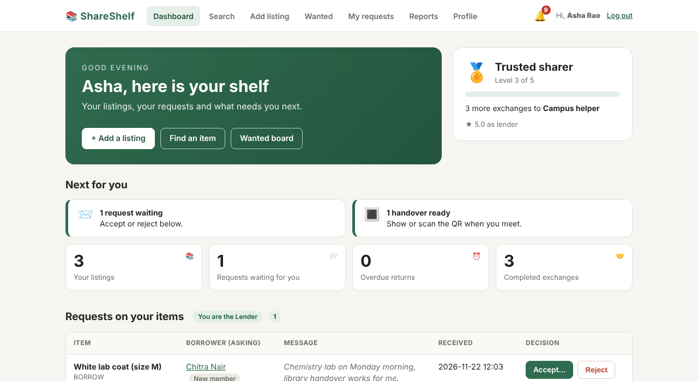

[Why](#-why-we-built-this) · [Features](#-features) · [Screenshots](#-screenshots) · [How it works](#-how-it-works) · [Architecture](#-architecture) · [Database](#-database) · [Run it](#-run-it-locally) · [Host it](#-deploying-it-online) · [Testing](#-testing) · [Docs](#-documentation) · [Team](#-meet-the-team)

## 👋 Why we built this
We are four BTech students at Galgotias University, and we live this problem. Every semester someone buys a scientific calculator, a lab coat or a drafter for one subject, uses it for a few weeks, and then it sits in a hostel cupboard. A few rooms away, another student is asking a WhatsApp group if anyone has one to lend. The answers get buried, nobody remembers who has what, and things quietly go missing.

ShareShelf is our fix, built by students for students: one place on campus to **list what you don't need, find what you do, and get it back on time**. We designed it around trust, because lending to a stranger only works if both sides feel safe. That is why a borrower's WhatsApp number stays hidden unless a return goes overdue.

## ✨ Features
| Feature | Description |
|---|---|
| 🔐 Registration & login | Galgotias email only (must contain your own admission number), salted PBKDF2 password hashing, session login, optional 30-day "keep me signed in" (only a hash of the token is stored) |
| 📦 List an item | Borrow, exchange, donate or giveaway listings; suggested borrow duration; fixed public handover spots |
| 🔎 Search & filter | Keyword (case-insensitive, trimmed) + category + type, combined |
| 🤝 Request workflow | Send, accept, reject, cancel (with a reason), hand over, return, with ownership checks on every action |
| 📱 QR handover & return | One-time QR token (6-digit fallback code, 10-minute expiry); the borrow clock starts when pickup is verified; condition check at return |
| ⏰ Due dates & overdue | The owner sets the return date; a background thread flags late returns as OVERDUE automatically |
| 🛡️ WhatsApp safety net | Contact is revealed to the owner **only** when a request is overdue, and every reveal is logged |
| 📱 Fix my WhatsApp number | On your own profile you can correct your WhatsApp number (password required), so a typo never breaks the overdue contact |
| ⭐ Ratings & trust levels | Mandatory mutual ratings after a return, profile pages with badges, and levels from Newcomer to Campus star |
| 📣 Wanted board | Post what you are looking for; others can offer to help |
| 🔔 Notifications & live updates | In-app notifications and 5-second live refresh, with no page reload |
| 📊 Reports | Live counts, **most-requested category** and **CSV export** |
| 🌍 Campus impact counter | The login page shows live totals (exchanges completed, items on the shelf, students sharing) from a public `GET /stats` endpoint |

## 📸 Screenshots
| Login (campus impact counter) | Dashboard |
|---|---|
| 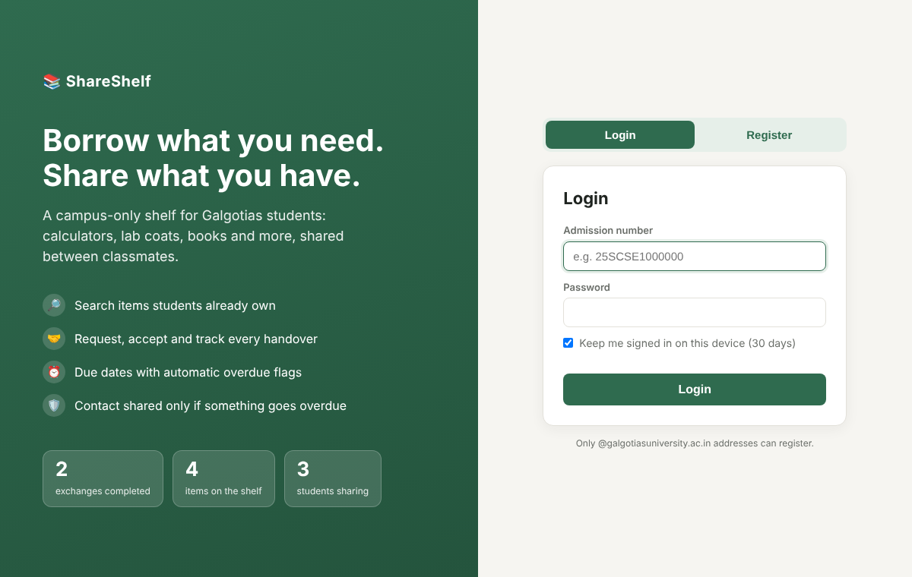 |  |

| Search | Requests |
|---|---|
| 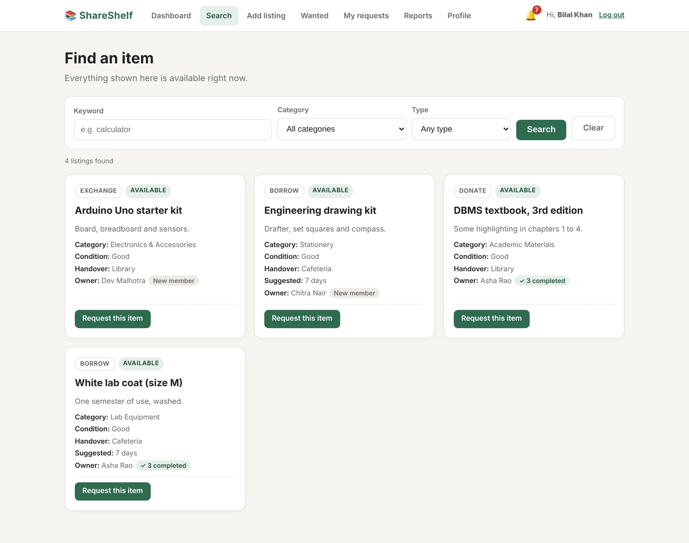 | 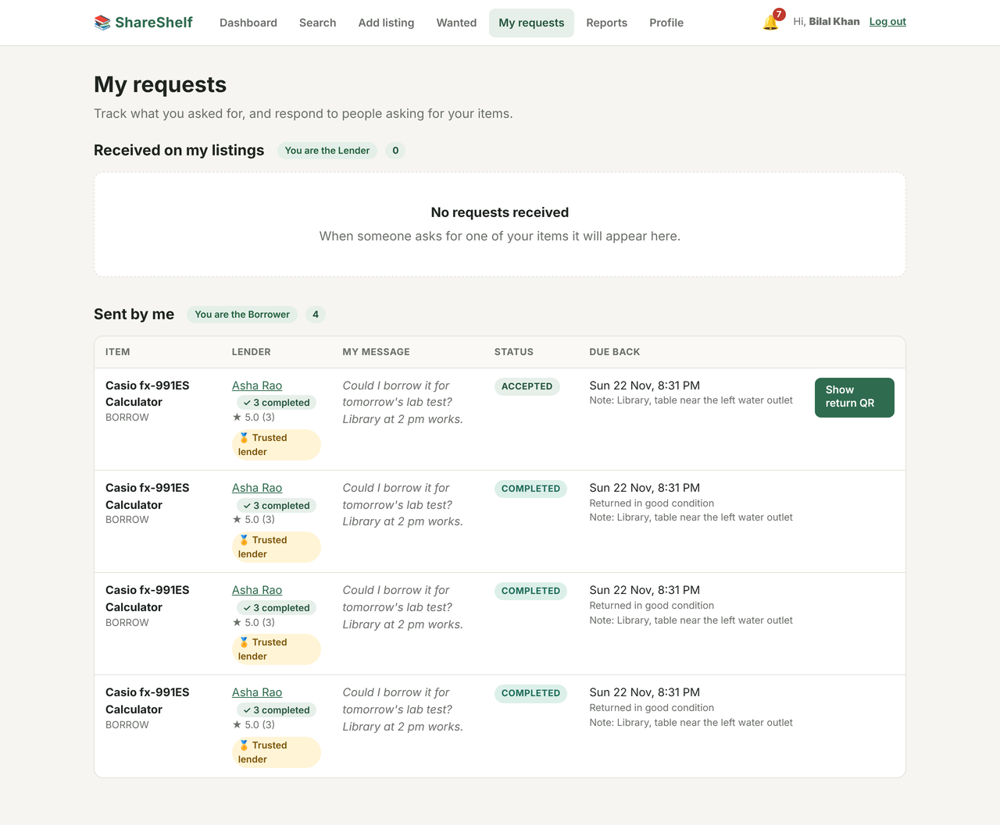 |

| Wanted board | Profile and trust level |
|---|---|
| 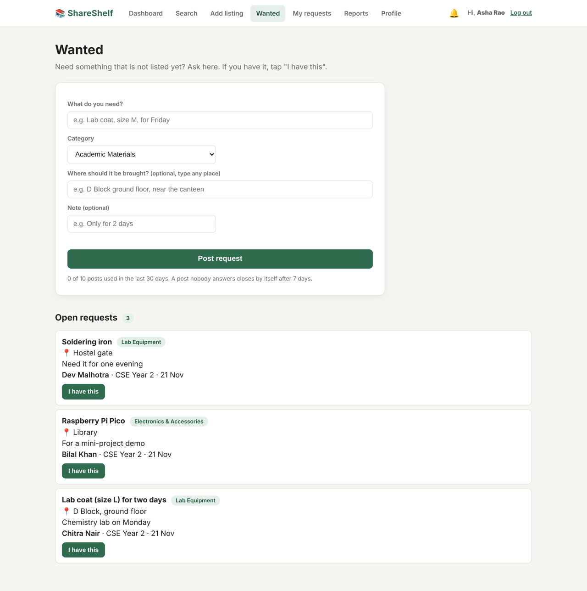 | 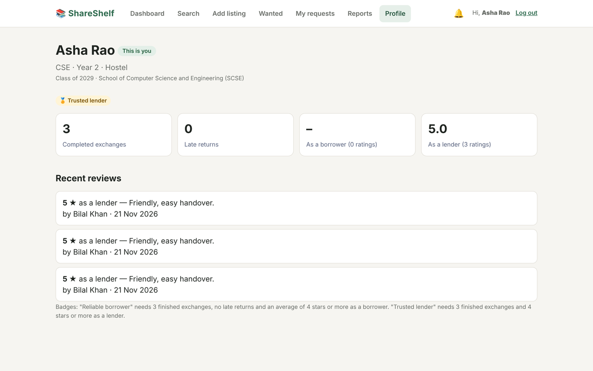 |

| Notifications | Reports |
|---|---|
| 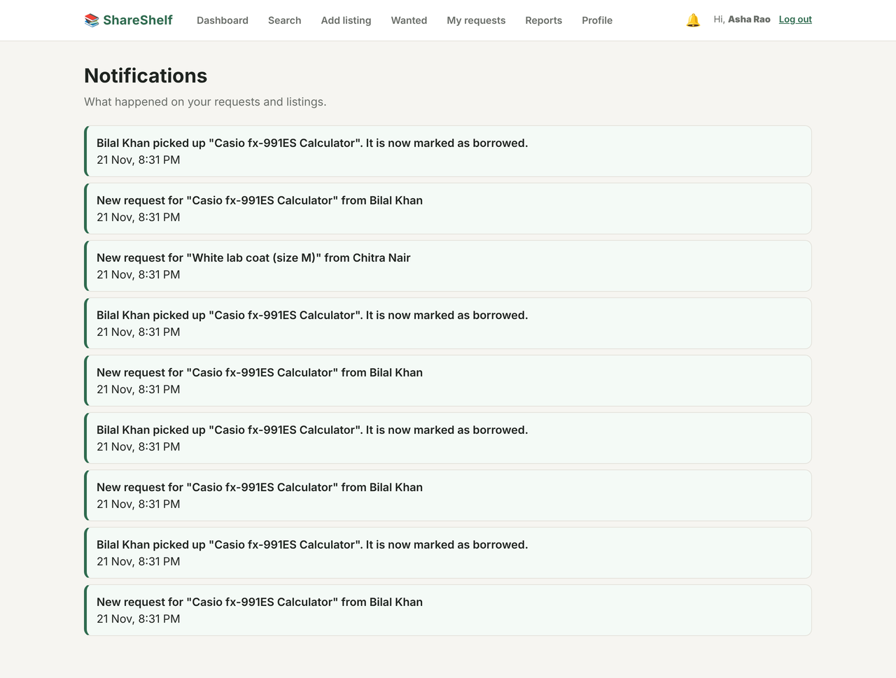 | 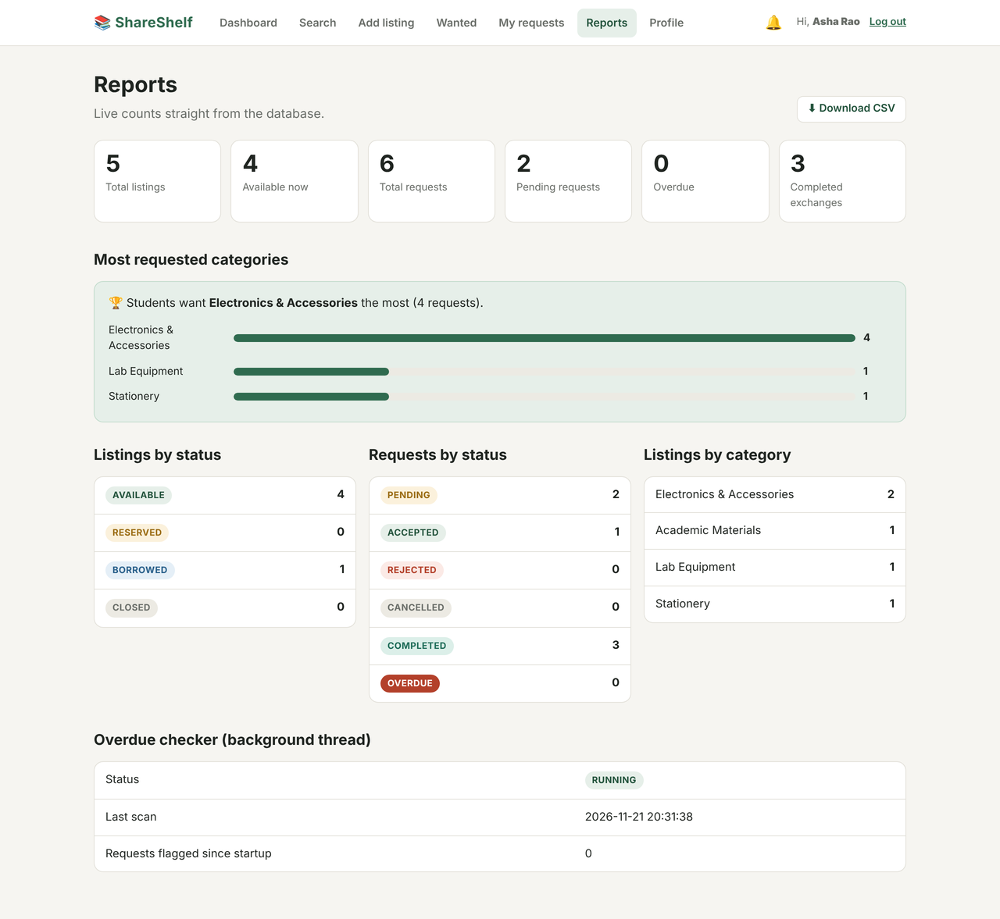 |

| QR return | Mobile |
|---|---|
| 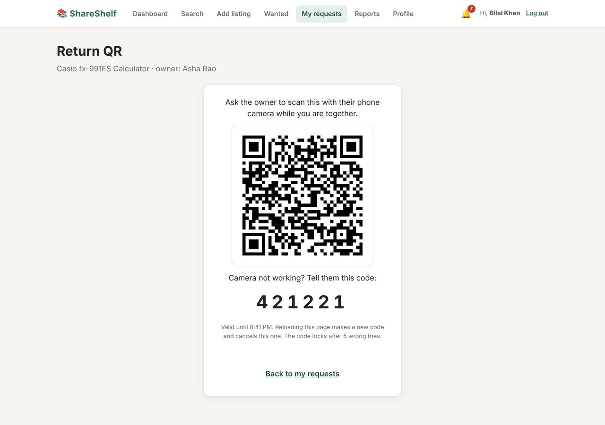 | 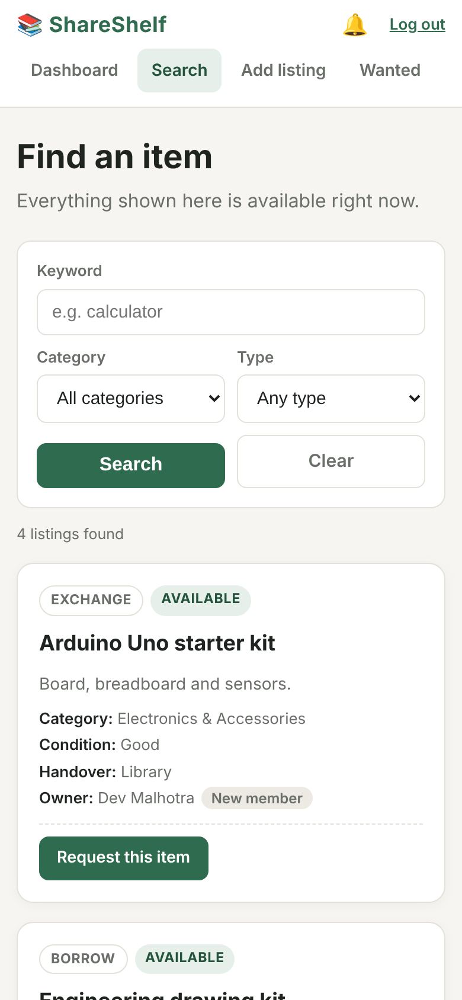 |

## 🔄 How It Works
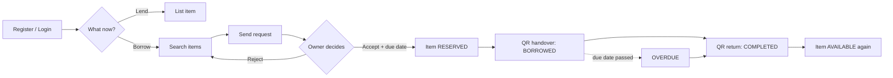
**Listing status:** `AVAILABLE → RESERVED → BORROWED → AVAILABLE` (or `CLOSED` for donate/exchange/giveaway)
**Request status:** `PENDING → ACCEPTED → COMPLETED`, or `REJECTED` / `CANCELLED`, or `OVERDUE` if the due date passes.

<details>
<summary><b>🛡️ Trust & safety design</b></summary>

- Only verified Galgotias email addresses can register, and the address must contain the student's own admission number.
- Borrowing sets a due date; late items are flagged **OVERDUE** automatically by a background thread.
- The requester's WhatsApp number is revealed to the owner **only when a request is overdue**; consent is captured at registration and every reveal is logged (`contact_reveal_logs` table).
- If the borrower and the owner registered the same WhatsApp number (for example two test accounts on one phone), nothing is revealed or logged, because the chat link would open the owner's own number.
- No GPS, no in-app chat, no payments. Handover spots are a fixed list of public campus places.
</details>

## 🏗️ Architecture
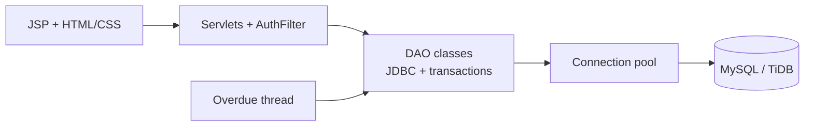
Servlets validate input and check ownership, DAOs hold **all** SQL (`PreparedStatement` everywhere, try-with-resources), JSPs only display data (every value is escaped with `<c:out>`). Full tree: [`docs/design/FOLDER_STRUCTURE.md`](docs/design/FOLDER_STRUCTURE.md).

<details>
<summary><b>☕ Core Java concepts used</b></summary>

- **OOP:** model classes mirroring the tables, `BaseServlet` inheritance (shared session/flash/redirect code), enums for types and statuses, a custom unchecked `DataAccessException`
- **Generics & interfaces:** a generic `Dao<T, ID>` interface implemented by the DAO classes, plus a generic `TtlCache<T>`
- **DAO pattern:** all SQL kept out of servlets; the multi-table workflows live in `RequestTransactionService`
- **Collections:** `List`, `Map`, `Set` (listings, report counts, vocabularies)
- **Exception handling:** try/catch, try-with-resources, a custom exception, safe fallbacks that never leak stack traces
- **Multithreading:** `ScheduledExecutorService` runs the overdue checker (a `Runnable`) on a daemon thread, started and stopped by a `ServletContextListener`; an exception in one scan never stops later scans
- **JDBC transactions:** accept, start-borrow, cancel, complete, reveal-contact and mark-overdue commit or roll back as one unit; `SELECT ... FOR UPDATE` and guarded `UPDATE ... WHERE status = ?` make them safe against double-clicks and races
- **Our own connection pool:** `ConnectionPool` reuses database connections (rolls back unfinished transactions on return, replaces old or dead connections), with unit tests
- **Security:** PBKDF2 password hashing with a random salt, session fixation protection, login filter, XSS-safe output, SQL-injection-safe queries, hashed remember-me tokens
</details>

## 🗄️ Database
Ten tables, all created by [`database/schema.sql`](database/schema.sql): `students`, `resource_items`, `requests`, `contact_reveal_logs`, `handover_tokens`, `notifications`, `ratings`, `wanted_posts`, `wanted_offers`, `remember_tokens`.
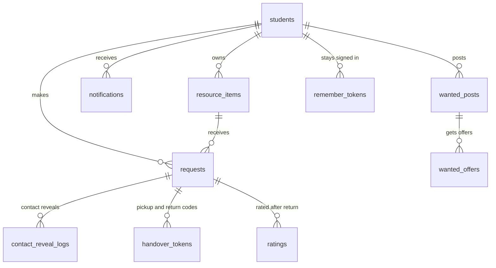
Hosted databases (Render + TiDB): use [`database/schema-hosted.sql`](database/schema-hosted.sql). **Upgrading an older database?** See [`database/migrations/`](database/migrations/README.md).

## 🚀 Run It Locally
**Requirements:** JDK 17+, Maven, MySQL 8, Tomcat 9 (not 10, which renamed `javax.servlet`).

1. **Clone**
   ```bash
   git clone https://github.com/RudraS-Chauhan/ShareShelf.git
   cd ShareShelf
   ```
2. **Create the database**
   ```bash
   mysql -u root -p < database/schema.sql
   ```
3. **Set your DB password** (never hardcoded, never committed). Either copy the template:
   ```bash
   cp src/main/resources/db.properties.example src/main/resources/db.properties   # then edit it
   ```
   or set environment variables `SHARESHELF_DB_URL`, `SHARESHELF_DB_USER`, `SHARESHELF_DB_PASSWORD`.
4. **Check the connection:** run `DBConnection.java` as a Java application; it prints `Database connection established successfully.`
5. **Build and deploy**
   ```bash
   mvn package
   cp target/ShareShelf.war <TOMCAT_HOME>/webapps/
   <TOMCAT_HOME>/bin/startup.sh        # startup.bat on Windows
   ```
   (Alternative without Tomcat: `mvn jetty:run`.)
6. **Open** http://localhost:8080/ShareShelf/ and register with a `@galgotiasuniversity.ac.in` address that contains your admission number. `http://localhost:8080/ShareShelf/hello` confirms the servlet pipeline.

The overdue-scan interval is the `overdueCheckMinutes` context parameter in `WEB-INF/web.xml` (default 5).

## 🌐 Deploying it online
Vercel cannot run Java servlets, so we deploy the same GitHub-push workflow on Render (Docker + Tomcat 9) with a hosted MySQL-compatible database (TiDB Cloud). Full step-by-step guide, including keeping the free tier awake: [`docs/guides/DEPLOYMENT.md`](docs/guides/DEPLOYMENT.md).

## 🧪 Testing
```bash
mvn test                      # 63 JUnit tests: 42 unit + 21 DAO tests (the DAO tests skip themselves if no DB is reachable)
python3 tests/e2e_smoke.py    # 179 end-to-end checks against the running app (empty DB)
```
New here? Follow the click-by-click guide in [`docs/testing/HOW_TO_TEST.md`](docs/testing/HOW_TO_TEST.md). Recorded results: [`docs/testing/TESTING.md`](docs/testing/TESTING.md). Test cases: [`docs/testing/TEST_CASES.md`](docs/testing/TEST_CASES.md).

## 📚 Documentation
| Folder | What is inside |
|---|---|
| [`docs/guides/`](docs/guides/) | Setup, deployment and the step-by-step build guide |
| [`docs/design/`](docs/design/) | User flows, UI guide, DAO contract and folder structure |
| [`docs/testing/`](docs/testing/) | Test cases, how to test, recorded results |
| [`docs/planning/`](docs/planning/) | Project summary, final spec, roadmap, Review 0 |
| [`docs/team/`](docs/team/) | Team roles and who did what |
| [`database/`](database/README.md) | Schema files and upgrade migrations |

Start with [`docs/README.md`](docs/README.md) for a one-line guide to each file.

## 🔭 Out of scope (future work)
Payments, in-app chat, image upload, push notifications, GPS, an admin moderation panel, CSRF tokens on forms, email verification of the college address.

## 👥 Meet the team
| | Name | What they own |
|---|---|---|
| 🧭 | **Rudra Singh Chauhan** (Team Leader) | Backend: servlets, DAOs, the request workflow, overall integration |
| 🗄️ | **Shreya Awasthi** | Database design: tables, constraints, the contact-reveal audit log |
| 📝 | **Pratyush Kumar Singh** | Documentation: specs, user flows, this README's structure |
| 🤝 | **Ram Ghelot** | Testing the flows and feedback on the screens |

Who did what, weekend by weekend: [`docs/team/TEAM_CONTRIBUTIONS.md`](docs/team/TEAM_CONTRIBUTIONS.md).

### How we worked
We planned the screens and flows first ([`USER_FLOWS`](docs/design/USER_FLOWS.md), [`UI_GUIDE`](docs/design/UI_GUIDE.md)), agreed on the database as a team ([`DAO_CONTRACT`](docs/design/DAO_CONTRACT.md)), then built layer by layer: database → DAOs → servlets → pages. After Phase 1 feedback (empty files, hardcoded credentials, non-standard layout) we rebuilt the project on the standard Maven layout, hashed passwords, and added automated tests so those problems cannot come back. After Review 1 we added the generic `Dao<T, ID>` interface, a JSON helper, and split the request DAO into reads and a transaction service.

### An honest note on tools
We used an AI assistant (Claude) heavily in Phase 2 to write and test much of the code. We reviewed it, ran it, and can explain every layer, and the 63 unit and 179 end-to-end checks in [`docs/testing/test-results/`](docs/testing/test-results/) are real runs. We list this openly because we would rather be upfront than overclaim.

## 🧭 What's next
Email verification of the college address, item photos, a read-only "peek" for visitors who have not signed in yet, and an admin moderation panel.

---
*Galgotias University · BTech 3rd semester · Java project-based evaluation · Made with ☕ in the hostels.*
