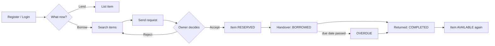
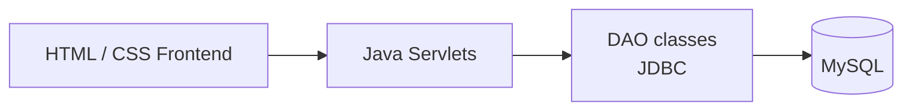
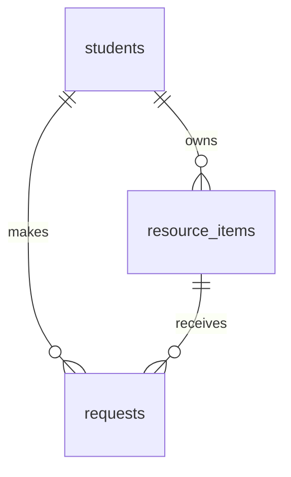

# 📚 ShareShelf

**A student-to-student resource-sharing platform for Galgotias University.** Borrow, exchange, donate, or give away campus items such as calculators, lab coats, notes, and books, with tracked requests and due dates.

   

> 🚧 **Review 1 snapshot.** This README is a work in progress. See [Project Status](#-project-status) for what is done and what is not.

---

## 🧭 Quick Navigation

[Problem](#-the-problem) · [Features](#-features) · [How it works](#-how-it-works) · [Architecture](#-architecture) · [Database](#-database) · [Run it](#-run-it-locally) · [Status](#-project-status) · [Team](#-team)

---

## ❓ The Problem

- Students own items they rarely use, while others buy the same items for one-time use.
- Borrowing happens informally over WhatsApp groups, with no record of who has what.
- There is no return tracking or trust signal, so items go missing.

## ✨ Features

| Feature | Description |
|---|---|
| 🔐 Registration & login | Galgotias email only, session-based login |
| 📦 List an item | Borrow, exchange, donate, or giveaway listings |
| 🔎 Search & filter | By keyword, category, and type |
| 🤝 Request workflow | Send, accept, reject, cancel, complete |
| ⏰ Due dates | Borrow duration sets an expected return date |
| 🚩 Overdue detection | Background thread flags late returns |
| ⭐ Reliability count | Number of completed exchanges per student |
| 📊 Reports | Summary of listings and requests |

Anyone can be both a lender and a borrower with the same account.

## 🔄 How It Works



<details>
<summary><b>🛡️ Trust & safety design (click to expand)</b></summary>

- Only verified Galgotias email addresses can register.
- Borrowing sets a due date, and late items are flagged **OVERDUE** automatically.
- The owner's WhatsApp number is revealed **only when a request is overdue**, and every reveal is logged.
- There is no GPS tracking and no in-app chat. There are no payments.

</details>

## 🏗️ Architecture



<details>
<summary><b>📁 Project structure (click to expand)</b></summary>

```
ShareShelf-Java/
├── pom.xml
├── schema.sql
├── docs/
└── src/main/
    ├── java/
    │   ├── model/     Student, ResourceItem, Request
    │   ├── dao/       StudentDAO, ListingDAO, RequestDAO
    │   ├── servlet/   Login, Register, AddListing, Search, SendRequest, ...
    │   └── util/      DBConnection, StaleReservationChecker
    └── webapp/
        ├── index.html
        └── css/style.css
```

</details>

<details>
<summary><b>☕ Core Java concepts used (click to expand)</b></summary>

- **OOP:** model classes with private fields, getters and setters
- **DAO pattern:** all SQL kept out of servlets
- **Collections:** `List` / `ArrayList` for query results
- **Exception handling:** try/catch and try-with-resources
- **Multithreading:** background thread marks overdue requests
- **JDBC:** `PreparedStatement`, plus transactions (commit/rollback) when accepting or completing a request

</details>

## 🗄️ Database

Three tables, defined in [`schema.sql`](schema.sql):

| Table | Purpose | Key columns |
|---|---|---|
| `students` | Registered users | `student_id` (PK), `email`, `whatsapp_number` |
| `resource_items` | Listed items | `item_id` (PK), `owner_id` (FK), `status` |
| `requests` | Borrow/exchange requests | `request_id` (PK), `item_id`, `requester_id`, `owner_id` (FKs), `expected_return_date` |



## 🚀 Run It Locally

<details>
<summary><b>Step-by-step setup (click to expand)</b></summary>

**Requirements:** JDK 17, Maven, MySQL 8.

1. **Clone**
   ```bash
   git clone https://github.com/RudraS-Chauhan/ShareShelf-Java.git
   cd ShareShelf-Java
   ```
2. **Create the database.** Open MySQL Workbench (or the `mysql` CLI), create a database named `shareshelf`, and run `schema.sql` against it.
3. **Set your DB password.** Edit `src/main/java/util/DBConnection.java` and set `USERNAME` and `PASSWORD` for your local MySQL. Do not commit your real password.
4. **Test the connection.** Run `DBConnection.java` as a Java application. It should print `Database connection established successfully.`
5. **Start the server**
   ```bash
   mvn jetty:run
   ```
6. **Open** http://localhost:8080/ShareShelf/ in your browser. Check http://localhost:8080/ShareShelf/hello to confirm the servlet pipeline works. If the context path differs, use the one Jetty prints in its startup log.

> Opening the HTML files directly (or with Live Server) only previews the static pages. Servlets need `mvn jetty:run`.

</details>

## ✅ Project Status

- [x] Requirements, design, and database schema
- [x] Model classes (`Student`, `ResourceItem`, `Request`)
- [x] `DBConnection` utility
- [x] Login and registration servlets
- [x] Login / registration page
- [ ] DAO integration (in progress)
- [ ] Add listing, search, and request servlets
- [ ] Dashboard and remaining pages
- [ ] Overdue-checker background thread
- [ ] Reports
- [ ] End-to-end testing

## 👥 Team

| Name | Role |
|---|---|
| Rudra Singh Chauhan | Team Leader, Backend |
| Shreya Awasthi | Database |
| Pratyush Kumar Singh | Documentation |
| Ram Ghelot | Member |

*Galgotias University, BTech 3rd semester, Java project-based evaluation.*
