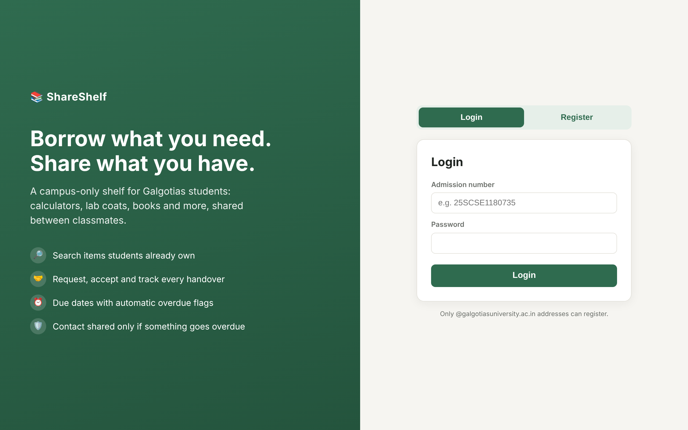
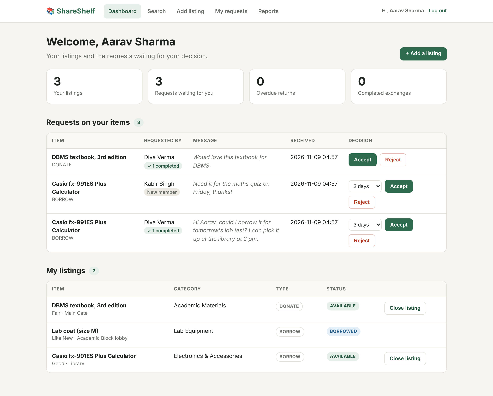
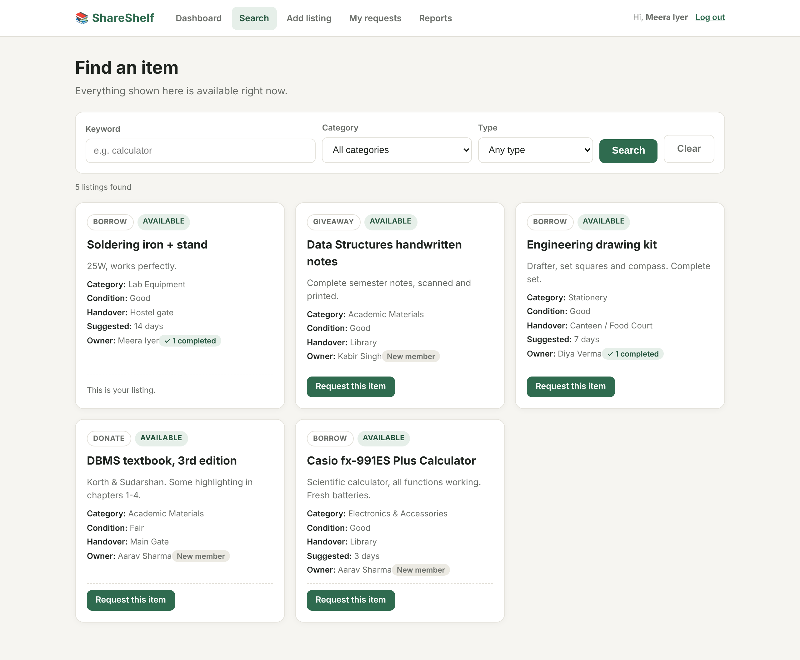
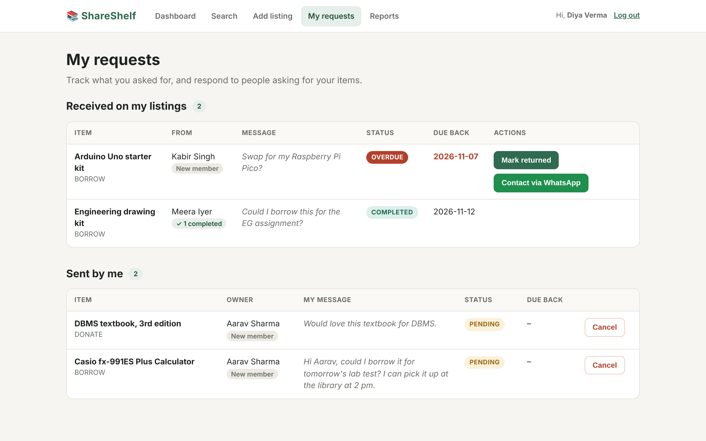
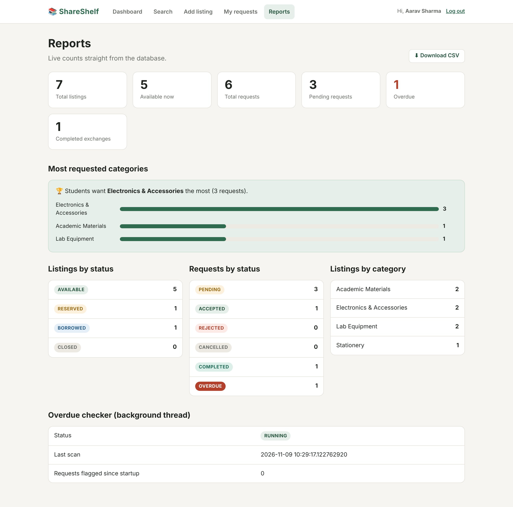
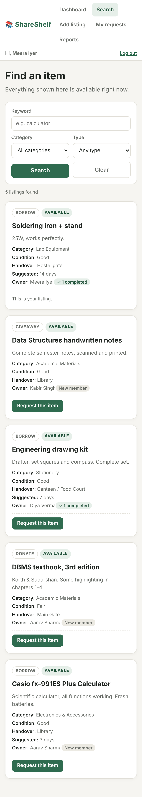
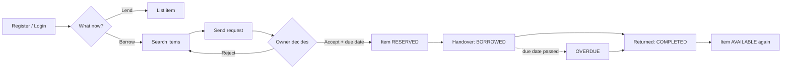
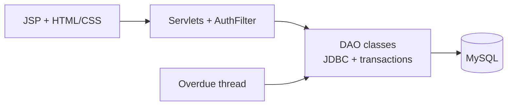
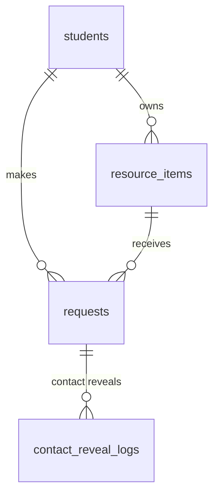

# 📚 ShareShelf

**A student-to-student resource-sharing platform for Galgotias University.** Borrow, exchange, donate, or give away campus items such as calculators, lab coats, notes, and books, with tracked requests, due dates and an overdue safety net.

   

[Problem](#-the-problem) · [Features](#-features) · [Screenshots](#-screenshots) · [How it works](#-how-it-works) · [Architecture](#-architecture) · [Database](#-database) · [Run it](#-run-it-locally) · [Host it](#-deploying-it-online) · [Testing](#-testing) · [Team](#-team)

## 👋 Why we built this
We are four BTech students at Galgotias University, and we live this problem. Every semester someone buys a scientific calculator, a lab coat or a drafter for one subject, uses it for a few weeks, and then it sits in a hostel cupboard. A few rooms away, another student is asking a WhatsApp group if anyone has one to lend. The answers get buried, nobody remembers who has what, and things quietly go missing.

ShareShelf is our fix, built by students for students: one place on campus to **list what you don't need, find what you do, and get it back on time**. We designed it around trust, because lending to a stranger only works if both sides feel safe. That is why a borrower's WhatsApp number stays hidden unless a return goes overdue.

## ❓ The Problem
- Students own items they rarely use, while others buy the same items for one-time use.
- Borrowing happens informally over WhatsApp groups, with no record of who has what.
- There is no return tracking or trust signal, so items go missing.

## ✨ Features
| Feature | Description |
|---|---|
| 🔐 Registration & login | Galgotias email only (must contain your own admission number), salted PBKDF2 password hashing, session-based login |
| 📦 List an item | Borrow, exchange, donate or giveaway listings; suggested borrow duration; fixed public handover spots |
| 🔎 Search & filter | Keyword (case-insensitive, trimmed) + category + type, combined |
| 🤝 Request workflow | Send, accept, reject, cancel, hand over, complete, with ownership checks on every action |
| ⏰ Due dates | The owner picks the return date when accepting a borrow request |
| 🚩 Overdue detection | A background thread flags late returns as OVERDUE automatically |
| 🛡️ WhatsApp safety net | Contact is revealed to the owner **only** when a request is overdue, and every reveal is logged |
| ⭐ Reliability count | Number of completed exchanges shown next to each student |
| 📊 Reports | Live counts + **most-requested category** + **CSV export** (innovation) |

## 📸 Screenshots
| Login | Dashboard | Search |
|---|---|---|
|  |  |  |

| Requests (overdue + WhatsApp) | Reports | Mobile |
|---|---|---|
|  |  |  |

## 🔄 How It Works

**Listing status:** `AVAILABLE → RESERVED → BORROWED → AVAILABLE` (or `CLOSED` for donate/exchange/giveaway)
**Request status:** `PENDING → ACCEPTED → COMPLETED`, or `REJECTED` / `CANCELLED`, or `OVERDUE` if the due date passes.

<details>
<summary><b>🛡️ Trust & safety design</b></summary>

- Only verified Galgotias email addresses can register, and the address must contain the student's own admission number.
- Borrowing sets a due date; late items are flagged **OVERDUE** automatically by a background thread.
- The requester's WhatsApp number is revealed to the owner **only when a request is overdue**; consent is captured at registration and every reveal is logged (`contact_reveal_logs` table).
- No GPS, no in-app chat, no payments. Handover spots are a fixed list of public campus places.
</details>

## 🏗️ Architecture

Servlets validate input and check ownership, DAOs hold **all** SQL (`PreparedStatement` everywhere, try-with-resources), JSPs only display data (every value is escaped with `<c:out>`). Full tree: [`docs/FOLDER_STRUCTURE.md`](docs/FOLDER_STRUCTURE.md).

<details>
<summary><b>☕ Core Java concepts used</b></summary>

- **OOP:** model classes mirroring the tables, `BaseServlet` inheritance (shared session/flash/redirect code), enums for types and statuses, a custom unchecked `DataAccessException`
- **DAO pattern:** all SQL kept out of servlets
- **Collections:** `List`, `Map`, `Set` (listings, report counts, vocabularies)
- **Exception handling:** try/catch, try-with-resources, a custom exception, safe fallbacks that never leak stack traces
- **Multithreading:** `ScheduledExecutorService` runs `StaleReservationChecker` (a `Runnable`) on a daemon thread; started and stopped by a `ServletContextListener`; an exception in one scan never stops later scans
- **JDBC transactions:** `accept()`, `complete()` and `revealContact()` commit or roll back as one unit; guarded `UPDATE ... WHERE status = ?` makes them safe against double-clicks and races
- **Security:** PBKDF2 password hashing with a random salt, session fixation protection, login filter, XSS-safe output, SQL-injection-safe queries
</details>

## 🗄️ Database
Four tables in [`schema.sql`](schema.sql): `students`, `resource_items`, `requests`, `contact_reveal_logs`.


## 🚀 Run It Locally
**Requirements:** JDK 17+, Maven, MySQL 8, Tomcat 9 (not 10, which renamed `javax.servlet`).

1. **Clone**
   ```bash
   git clone https://github.com/RudraS-Chauhan/ShareShelf-Java.git
   cd ShareShelf-Java
   ```
2. **Create the database**
   ```bash
   mysql -u root -p < schema.sql
   ```
3. **Set your DB password** (never hardcoded, never committed). Either copy the template:
   ```bash
   cp src/main/resources/db.properties.example src/main/resources/db.properties   # then edit it
   ```
   or set environment variables `SHARESHELF_DB_URL`, `SHARESHELF_DB_USER`, `SHARESHELF_DB_PASSWORD`.
4. **Check the connection:** run `DBConnection.java` as a Java application; it prints `Database connection established successfully.`
5. **Build and deploy**
   ```bash
   mvn package
   cp target/ShareShelf.war <TOMCAT_HOME>/webapps/
   <TOMCAT_HOME>/bin/startup.sh        # startup.bat on Windows
   ```
   (Alternative without Tomcat: `mvn jetty:run`.)
6. **Open** http://localhost:8080/ShareShelf/ and register with a `@galgotiasuniversity.ac.in` address that contains your admission number. `http://localhost:8080/ShareShelf/hello` confirms the servlet pipeline.

The overdue-scan interval is the `overdueCheckMinutes` context parameter in `WEB-INF/web.xml` (default 5).

## 🧪 Testing
```bash
mvn test                      # 24 JUnit tests (DAO integration tests skip themselves if no DB is reachable)
python3 tests/e2e_smoke.py    # 98 end-to-end checks against the running app (empty DB)
```
New here? Follow the click-by-click guide in [`docs/HOW_TO_TEST.md`](docs/HOW_TO_TEST.md). Recorded results: [`docs/TESTING.md`](docs/TESTING.md). Test cases: [`docs/TEST_CASES.md`](docs/TEST_CASES.md).

## 🔭 Out of scope (future work)
Payments, in-app chat, image upload, push notifications, GPS, an admin moderation panel, CSRF tokens on forms, email verification of the college address.

## 🌐 Deploying it online
Vercel cannot run Java servlets, so we deploy the same GitHub-push workflow on Render (Docker + Tomcat 9) with a hosted MySQL. Full step-by-step guide: [`docs/DEPLOYMENT.md`](docs/DEPLOYMENT.md). Hosted-database tables: [`schema-hosted.sql`](schema-hosted.sql).

## 👥 Meet the team
| | Name | What they own |
|---|---|---|
| 🧭 | **Rudra Singh Chauhan** (Team Leader) | Backend: servlets, DAOs, the request workflow, overall integration |
| 🗄️ | **Shreya Awasthi** | Database design: tables, constraints, the contact-reveal audit log |
| 📝 | **Pratyush Kumar Singh** | Documentation: specs, user flows, this README's structure |
| 🤝 | **Ram Ghelot** | Team member: testing the flows and feedback on the screens |

Who did what, weekend by weekend: [`docs/TEAM_CONTRIBUTIONS.md`](docs/TEAM_CONTRIBUTIONS.md).

### How we worked
We planned the screens and flows first (`docs/USER_FLOWS.md`, `docs/UI_GUIDE.md`), agreed on the database as a team (`docs/DAO_CONTRACT.md`), then built layer by layer: database → DAOs → servlets → pages. After Phase 1 feedback (empty files, hardcoded credentials, non-standard layout) we rebuilt the project on the standard Maven layout, hashed passwords, and added automated tests so those problems cannot come back.

### An honest note on tools
We used an AI assistant (Claude) heavily in Phase 2 to write and test much of the code. We reviewed it, ran it, and can explain every layer, and the 24 unit and 98 end-to-end checks in `docs/test-results/` are real runs. We list this openly because we would rather be upfront than overclaim.

## 🧭 What's next
Email verification of the college address, item photos, in-app notifications, and an admin moderation panel.

---
*Galgotias University · BTech 3rd semester · Java project-based evaluation · Made with ☕ in the hostels.*
